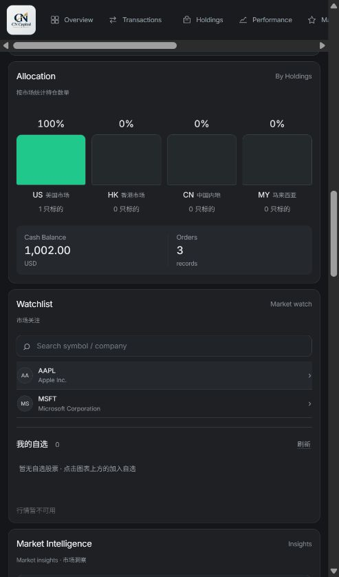
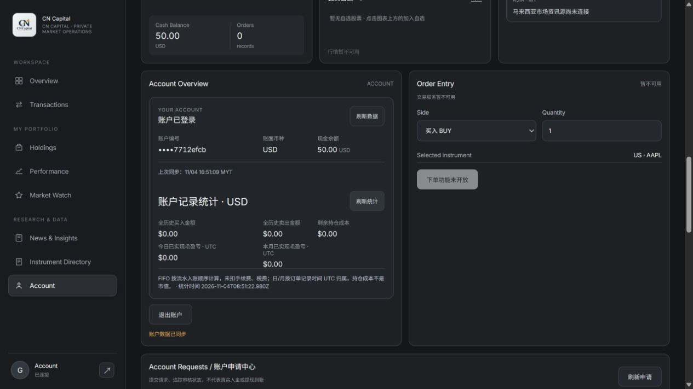

# 账户真实记录统计：交付与验收

日期：2026-11-04。分支 `codex/admin-integration-20261104`，本轮起点 `1f43d02`。用户确认免费阶段暂保留 TV 图表和标识，先补齐账户内可计算统计。未改原图表模块、未推送、合并、部署、绑定域名或写入既有 QA/生产数据库。

## 已完成

- 新增只读 GET `/api/account/analytics`，从客户会话取 accountId；管理员令牌不可调用客户接口，传入其他账号参数也不能改变读取对象。
- 在同一个 REPEATABLE READ READ ONLY 事务内读取现金、持仓、完整订单及对应流水，成功提交，失败回滚并释放连接。无数据库迁移或新依赖。
- FIFO 按 `cash_ledger.id` 的实际入账顺序匹配买入成本，避免事务开始时间/随机 UUID 排序影响成本；核对流水方向及 USD 金额。缺流水、金额不符、缺买入、持仓不一致、非法数值或溢出时不输出推算盈亏。
- 以 BigInt 分摊部分卖出的成本，保留每笔买入原有整数分值；全卖完时分摊总成本精确等于原成本。
- 前台显示完整历史买卖总额、全历史订单数、FIFO 已实现毛盈亏、剩余持仓成本、今日/本月已实现毛盈亏。日/月仅按订单记录时间 UTC 归属，不是组合总盈亏或净值回报，手续费/税费未扣。
- 无持仓时显示账户现金总额，并明确“仅现金”；有持仓但缺少报价时总市值仍不显示。成本不充当市值。
- 登录、账户刷新和独立统计刷新均已接入；失效/退出清理数据，迟到响应不覆盖新会话，统计失败不影响其他业务模块。
- 列表仍加载最近最多100笔；统计读取完整历史。页面明确说明筛选、分页与导出仅作用于已加载记录，导出按钮改为 Export Loaded Records，避免把部分历史误当全部导出。

## 文件

| 文件 | 作用 |
|---|---|
| `src/account-analytics.mjs` | FIFO 纯计算、来源一致性验证、只读数据库统计服务 |
| `src/http-api.mjs` | 新增客户统计路由、方法和现有会话/角色边界 |
| `web/app.mjs`, `web/index.html` | 统计加载/错误/会话生命周期、账户统计区、全历史汇总、现金值和已加载记录范围 |
| `test/account-analytics.test.mjs` | 分摊、损益、市场身份、UTC归属、入账顺序、异常及只读事务回归 |
| `test/account-analytics-api.test.mjs` | 认证、角色、方法及账户隔离 |
| `test/account-analytics-ui.test.mjs` | 完整历史显示、无报价/异常/迟到结果和会话清理 |
| `test/postgres-integration.test.mjs` | 实际SQL验证超过100笔、完整盈亏、时间错序及异常流水/持仓 |
| `docs/API.md`, `docs/page-data-gap-audit-2026-11-04.md` | 接口契约及仍需外部数据的部分 |
| `docs/superpowers/specs/2026-11-04-account-analytics-design.md`, `docs/superpowers/plans/2026-11-04-account-analytics.md` | 本轮范围、计算口径和执行记录 |

## 验证证据

全量真实 PostgreSQL 16 测试：**157 项，140 通过、0 失败、17 外站检查跳过**。4 项真实数据库集成全部运行。新的空测试库执行迁移两次；没有复制现有业务数据。

- >100 笔案例：121 笔内部订单，买入120.00 USD、卖出180.00 USD，毛已实现60.00 USD。账户接口只返回100笔，统计仍返回121笔和完整结果。
- 入账顺序案例：不同成本买入的记录时间人为倒序，仍按实际流水序号计算正确成本；随后仅在该合成库中将持仓或流水金额改错，接口返回不可计算及明确原因。
- 独立复核发现时间排序不可靠后，补了先失败再通过的回归。复审独立运行9项纯计算/DOM全部通过，未发现新的重要问题。复核工具环境的本机HTTP连接曾 EACCES；主流程HTTP和真实数据库测试均实际完成，不将该环境问题当测试通过。
- 构建脚本在新的 `.local-postgres/account-analytics-build-20261104` 运行成功，保留仓库已有 `public/`，没有覆盖旧产物。
- 修改的产品 JavaScript 通过语法检查；差异空白检查通过。

### 浏览器人工可验算案例

在 `127.0.0.1:3187` 的全新合成库，使用实际内部订单服务生成：

| 操作 | 数量 × 记录价格 | USD 金额 |
|---|---|---|
| 买入一 | 3 × 1.00 | 3.00 |
| 买入二 | 2 × 1.50 | 3.00 |
| 卖出 | 4 × 2.00 | 8.00 |

FIFO 卖出成本为3.00+1.50=4.50；已实现毛盈亏为8.00−4.50=**3.50**；剩余1股成本为**1.50**；买卖总额为**14.00**。浏览器实际显示相同结果，现金1002.00，持仓1股；缺少报价，因此总市值显示不可计算。

退出后登录另一合成客户：仅现金50.00、无持仓无订单，显示现金总额50.00与零已实现盈亏，没有前一账号残留。

两个账号最终退出，本地应用和数据库进程已停止，测试端口无残留监听；文件和合成数据保留。日志在工作区 `.local-postgres/account-analytics-full.log`。

## 仍未完成，不能宣称整页外部数据已接通

- 持仓最新价、完整组合估值、包含浮盈亏的日收益、月度净值回报仍缺报价/历史估值/现金流数据源。
- 股息没有实际入账记录来源；风险没有已确认模型；新闻源未接入。
- TV 图表及标识按用户本次选择保留。没有采集图表中的价格去填充账户或用于下单。本轮不新增对各交易所图表可用性的验收承诺。
- 统计仅反映平台内部订单及账面持仓，并非券商成交、税务报表或净收益。UTC日/月归属是订单记录时间，不是外部交易所交易日或结算日。
- 端点每次读取完整账户订单，时间/内存随该账户历史增长；尚未做超大历史负载测试或引入汇总表。为了不截断成本，不使用最近100笔代替完整历史。
- 交易列表/筛选/导出仍是已加载的最近最多100笔，未新增全量历史下载或数据库分页。
- 未验收原生APP、所有屏幕尺寸、长期运行或线上生产；未接支付、借贷、身份核验或券商执行。

## 运行

在仓库目录执行 `npm test`；未设置测试库时4项数据库测试会明确跳过。真实数据库测试只用全新本机空库，设置 `DATABASE_URL`、`DATABASE_URL_UNPOOLED`、`TEST_DATABASE_URL`，应用迁移后运行 `npm test`。本地开发用 `npm run dev:api`，默认本机端口3001，读取最新 `web/`。运行已有构建命令前检查其会替换的 `public/`；本轮通过新目录构建避免覆盖。
