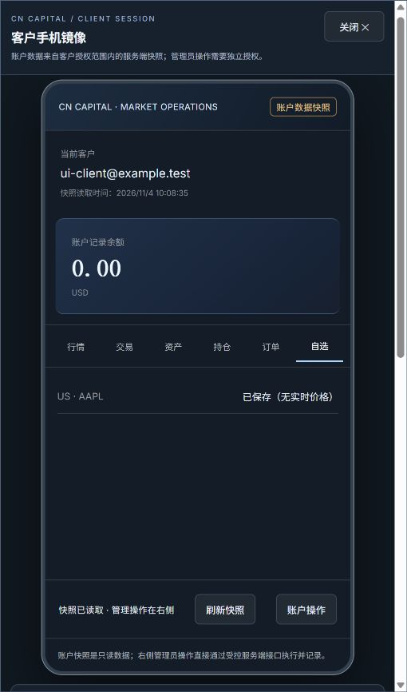
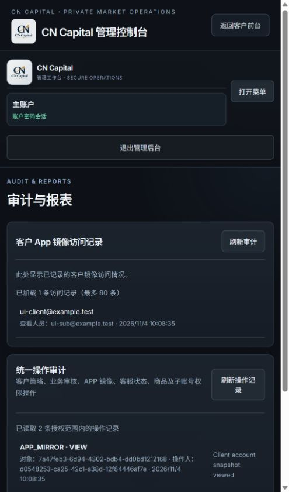

# 本地真实浏览器实测记录

日期：2026-11-04。代码基点：本地提交 `0230d4a`，分支 `codex/admin-integration-20261104`。本轮未修改产品代码。

环境：ChatGPT in-app browser 的真实浏览器页面，当前窄屏视口；前后台地址固定为 `http://127.0.0.1:3187`，仅绑定本机回环地址。新建独立空 PostgreSQL 数据库，应用现有迁移并创建合成主管理员、两个子管理员和分别归属两人的客户。没有复制或连接既有 QA/生产数据。

| 检查项 | 实际操作与结果 |
|---|---|
| 主管理员登录及客户详情 | 浏览器输入测试账号登录成功；目录显示两名测试客户；可打开指定客户资料、账户管理与策略表单 |
| 策略保存与审计 | 将合成客户 VIP 从普通改为黄金，输入确认密码和原因后保存；页面读回黄金、版本 1，并显示相同原因的变更审计 |
| 子管理员隔离 | 退出主账号后登录所属子管理员；目录显示 1/1 客户，没有另一子管理员的客户；客户策略为只读，仍可看到主账号保存的黄金及变更记录 |
| 前台与后台镜像联动 | 在另一个真实浏览器标签中登录客户，点击加入 AAPL 自选，前台显示我的自选 1；后台以子管理员打开该客户镜像，自选页显示 US · AAPL 已保存，余额 0.00 USD |
| 镜像只读边界 | 子管理员镜像策略区明确只读，未提供主账号策略修改表单；镜像没有真实交易执行 |
| 会话被撤销后的清理 | 仅在本轮合成数据库撤销测试子管理员会话，再点击后台刷新客户；页面返回登录入口并显示登录失效；DOM 中客户列表和统一审计为空，镜像只剩请选择客户提示 |
| 统一审计 | 重新以主管理员登录并打开审计页；镜像访问记录显示测试子管理员和客户，统一审计显示 APP_MIRROR VIEW 与 CLIENT_POLICY vipTier 两条事件 |
| 正常退出 | 主管理员与客户分别点击退出，均回到各自登录入口 |
| 浏览器控制台 | 采集主/客户两个标签的 error 日志，均为空 |

## 证据

截图只包含本轮合成测试账号和记录。当前视口较窄，截图展示响应式布局，不代表全部桌面/设备尺寸都已验收。

## 边界及清理

- 所有修改仅落在本轮新建的本地合成数据库；没有推送、合并、部署、域名操作或生产数据修改。
- 未执行资金划转、借贷、身份验证或券商交易；没有保存浏览器密码。
- 本地应用和测试数据库进程在实测后停止，文件和合成数据保留；未删除文件。
- 这次补足此前的本地真实浏览器操作验证。尚未覆盖真实手机/触屏、全部桌面分辨率、长时间操作、原生 iOS/Android APP 或任何线上环境。
- 跨账号 API 越权、事务回滚、并发版本和审计故障注入的证据仍以先前通过的真实 PostgreSQL 集成测试为准，本轮不将浏览器目录可见性当作这些服务端检查的替代品。
