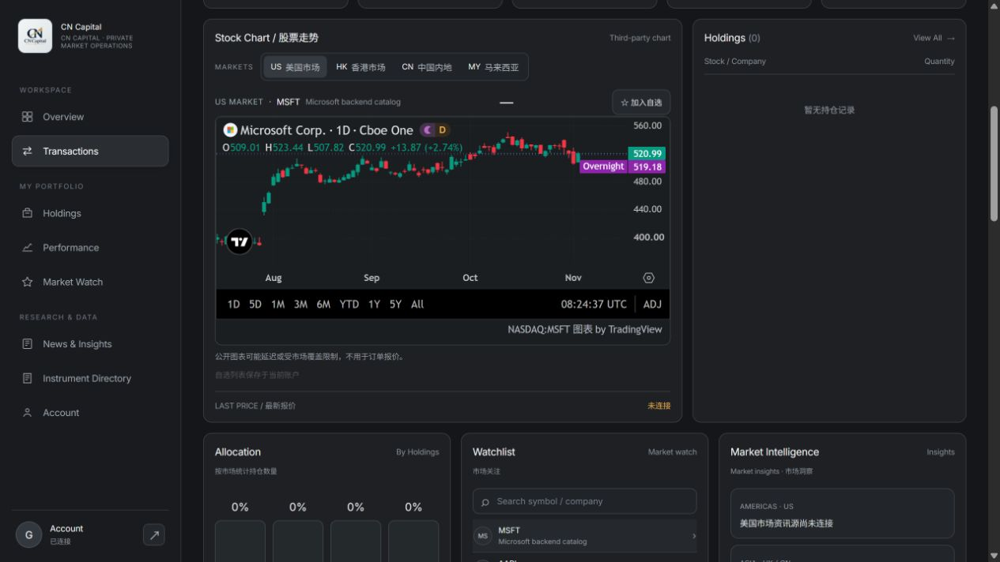
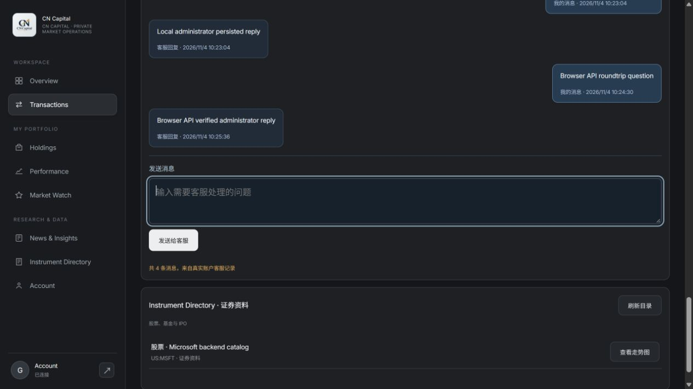

# 前台 API 与公开走势图交付记录

日期：2026-11-04。分支：`codex/admin-integration-20261104`，本轮起点 `f906476`。唯一仓库仍为 `dalulu05168/global-stock-platform`。

## 用户确认的范围

前台全部现有业务模块接现有后台 API；用户没有行情供应商账号，明确选择先接公开走势图。未新增行情订阅、付费服务或交易权限。没有推送、合并、部署、域名操作，未接触既有 QA/生产数据库。

## 本轮修改的文件

| 文件 | 解决的问题 |
|---|---|
| `web/app.mjs` | 登录、刷新和恢复会话时同步账户、持仓、订单、自选、证券、三类申请、商品和客服；任一受保护接口 401 清理会话；旧请求不能覆盖新账号数据；退出服务失败仍清除本机数据并提示服务端撤销未确认；后台证券可选入图表，持仓/订单名称优先使用后台已发布元数据；修复提交后刷新期间切换账号造成的草稿清空/客服状态覆盖 |
| `web/stock-chart.mjs` | 复用已有官方公开图表组件，采用匹配前台的深色主题；保留官方来源及加载失败/不支持标的提示 |
| `web/index.html` | 加入公开图表可能延迟、受覆盖限制且不用于订单报价的说明 |
| `web/styles.css` | 修复外部图表深色背景选择器优先级；不重做页面布局 |
| `src/http-api.mjs` | Node 静态路由允许加载 `stock-chart.mjs`，修复实际模块无法访问的缺口 |
| `test/client-api-wiring.test.mjs` | 10 项前台数据与会话回归测试，覆盖初始同步、401、退出失败、跨账号迟到响应、目录选股/图表、后台名称、旧提交/客服回调以及会话关闭 |
| `test/public-entry-integrity.test.mjs`, `test/stock-chart.test.mjs`, `test/web-ui.test.mjs` | 验证图表模块路由、主题、登录后加载、切换标的和未开放下单；更新原来要求图表始终不可用的历史断言 |
| `docs/superpowers/specs/2026-11-04-client-api-chart-design.md`, `docs/superpowers/plans/2026-11-04-client-api-chart.md` | 保存用户选择、实施范围及执行结果 |

## 接口连接状态

| 前台数据/操作 | 接口 | 本轮结果 |
|---|---|---|
| 账户余额、持仓、历史订单与交易明细 | GET `/api/account` | 保留原有数据库读取；与其他模块同步，不根据公开图表编造估值或成交 |
| 自选读取/加入/移除 | GET/POST/DELETE `/api/watchlist` | 保留已接链路，补充会话失效清理及图表入口 |
| 后台发布的证券 | GET `/api/catalog` | 目录、选股、图表入口、持仓与交易名称联动；STOCK/FUND 可选择查看 |
| 充值/提现、身份工单、银行末四位登记 | GET/POST `/api/requests` | 登录即读已有记录，提交后刷新；后台审核状态可回传前台 |
| 商品目录 | GET `/api/commodities` | 登录即读后台发布商品；人工参考价有明确标记 |
| 客服消息 | GET/POST `/api/support` | 初始读取、前台发送、后台回复及刷新回传；保留关闭状态 |
| 股票走势图 | TradingView 官方公开嵌入 | 浏览器实际显示 MSFT 图表，标有延迟数据；与内部报价/订单服务独立 |
| 成交报价、实时行情 API、实盘订单 | 未配置供应商/券商 | 本轮不启用；外部图表不能解锁订单按钮 |

## 实际验证

- 定向新增测试均针对对应缺陷观察失败后修复；10 项接线回归最终全部通过。
- 独立审查先发现两项跨账号提交完成回调遗漏，修复后再次复核；10 项独立运行全部通过，未发现新的重要问题。
- 全量真实 PostgreSQL 16：**146 项，129 通过、0 失败、17 外站检查按边界跳过**。3 项数据库集成全部执行；每轮使用新的空数据库，迁移重复运行通过。
- 测试日志：工作区 `.local-postgres/client-wiring-full.log`。未使用生产或旧 QA 快照数据。
- `node --check` 对修改的产品模块通过；差异空白检查通过。
- 实际构建脚本在新目录 `.local-postgres/client-build-20261104` 运行，成功生成 `public/index.html`、`public/app.mjs`、`public/stock-chart.mjs`。仓库原 `public/` 保留，没有覆盖；本地开发服务读取 `web/`，不是旧生成目录。

### 真实浏览器结果

本地源固定 `http://127.0.0.1:3187`；全新空库中合成账号和记录，没有真实资金或个人资料。正常登录后：

1. 自动显示预先持久化的 12.34 USD 申请、商品 GOLD-LOCAL、客服历史和后台发布的 MSFT 名称，无需额外点击各模块刷新。
2. 点击证券目录“查看 US MSFT 走势图”，标题使用后台名称，官方 iframe 实际显示 Microsoft 股票日线；iframe 明确标有 Data is delayed，平台报价仍为空，订单按钮未开放。
3. 前台提交 23.45 USD 合成申请，后台客户详情及审批列表读到相同记录；后台转入 UNDER_REVIEW 后，前台刷新显示“审核中”。没有批准付款或改变余额。
4. 前台发送合成客服问题，后台读到后回复；前台刷新显示对应客服回复，共 4 条持久消息。
5. 主/客户分别正常退出回到登录入口；本地应用及 PostgreSQL 服务已停止，无残留测试监听端口，文件与合成数据保留。

## 已知限制与未完成项

- 本轮公开图表不等于完整实时行情 API。数据授权、覆盖范围及延迟由第三方决定；当前精确映射仅覆盖源代码中 8 个参考标的，其余后台/自选代码不猜测交易所映射，显示未配置第三方图表。IPO 不提供图表选择按钮。
- 真实浏览器实际确认的是 MSFT 图表，不将一个成功标的扩大为全部四个市场都已逐只验收。
- 浏览器采集到 TradingView 自带 `/support/support-portal-problems/?language=en` 请求的两条 403 错误日志。MSFT 图表仍正常显示；未修改或绕过第三方限制，不能宣称控制台完全无错误。
- 总资产估值、日/月盈亏、股息、风险评分、新闻源没有新增数据源；继续明确显示缺少数据，未编造数值。贷款资格仍只是策略字段，没有贷款申请接口。
- 无供应商授权报价、真实支付/贷款、外部身份/银行卡核验、券商执行；公开走势图不能替代这些服务。现有内部订单历史可读，但提交订单仍默认禁用。
- 未验收所有桌面/手机尺寸、长期运行、原生 iOS/Android 或线上部署。

官方依据：[Advanced Chart widget](https://www.tradingview.com/widget-docs/widgets/charts/advanced-chart/)、[数据及延迟说明](https://www.tradingview.com/widget-docs/faq/data/)。保留官方品牌和来源，不抓取 iframe 价格。

## 运行与复测

在仓库安装已有依赖后运行 `npm test`。数据库集成只用新的本机空库，明确设置 `DATABASE_URL`、`DATABASE_URL_UNPOOLED`、`TEST_DATABASE_URL` 后应用迁移再运行测试；不要使用现有业务库。运行 `npm run dev:api` 读取最新 `web/`，浏览器打开本机端口（默认 3001）。公开图表需要浏览器可访问 TradingView 官方域名。使用 `npm run build` 前检查其会替换的 `public/`，本轮已通过独立目录验证避免覆盖。
